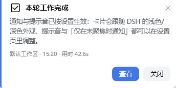
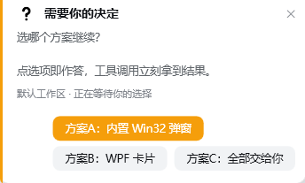
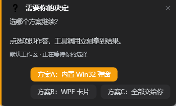

# dsh-desktop-notifier

在 **Windows 桌面右下角** 弹出通知卡片与选择卡片的 DeepSeek Harness Host 插件。

- **完成通知**：一轮对话结束时，弹出「本轮工作完成」卡片（含本轮最后一段回复、工作区名、时间、用时，按钮「查看 / 关闭」）。
- **出错通知**：一个 step 失败时，弹出「本轮出错」卡片（红色强调，按钮「关闭」）。
- **选择判断弹窗**：模型调用 `ask_user_question` 时，把问题与选项做成原生卡片；**点选项即作答**，工具调用立刻拿到答案。关闭/超时/无法渲染时自动回落到 DSH 自带的 Web UI 对话框，行为与未装插件时一致。
- **跟随外观**：卡片配色取 DSH 设计 token，默认 `theme: auto`——DSH 是浅色就弹浅色卡，切到深色就弹深色卡（偏好为「跟随系统」时再读 Windows 应用主题）。

实现：Host 插件（Node，触发事件）+ `scripts/popup.ps1`（WPF，Windows PowerShell 5.1 即可，不需要 PowerShell 7）。

## 界面预览

完成通知（浅色外观）：



选择判断卡片（浅色 / 深色，深色主题下自动换深色配色）：

<p>


</p>

## 安装

```powershell
git clone https://github.com/Mi-liu/dsh-desktop-notifier.git
```

把克隆下来的目录用 DSH 的 `plugin_manager` 装进 profile：

```
plugin_manager
  action:  install_bundle
  target:  file:<克隆目录的绝对路径>     # 例如 D:/tools/dsh-desktop-notifier
```

依赖：Node 侧只用到 `@deepseek-ai/schemastery`（DSH 自带的直接可解析；独立测试时 `npm i` 即可）；弹窗由 `scripts/popup.ps1` 负责，只需要 **Windows PowerShell 5.1 + .NET Framework 4.x**（Win10/11 自带），不需要 PowerShell 7。

安装后可在 GUI「插件」页看到 `dsh-desktop-notifier`，用它旁边的开关启停（开关写的是 profile 覆盖，不会与 bundle patch 里的行重复）。

> **设置页需要重启一次应用才会出现。** DSH 的客户端模块图在宿主启动时扫描每个包的 `dsh.client` 声明并缓存到进程结束，所以**第一次装好本插件（或插件新加了客户端半侧）后，要完全退出 DSH 再打开**，GUI 里才会多出「设置 → 桌面通知」。之后改设置即时生效，不需要再重启。

## 设置页

GUI **设置 → 桌面通知** 里可以直接改全部选项（翻译见 `locale/`），改完立刻对下一次弹窗生效，不用重启：

| 分组 | 选项 |
| --- | --- |
| 通知范围 | 总开关、完成通知、出错通知、接管 `ask_user_question` |
| 通知条件 | **何时通知**：`始终通知` / `仅在 DSH 未聚焦时通知`（Harness 在前台时连卡片带声音一起跳过） |
| 提醒方式 | **提示音**：默认（按卡片类型）/ 静音 / 系统通知 / 叮 / 风铃 / 完成音 / 邮件 / 日历 / 消息 / 轻提示 / 系统提示 / 提问音 / 提示音 / 警告音 / 错误音 |
| 外观与交互 | 卡片外观（跟随 DSH 外观 / 浅色 / 深色 / 跟随 Windows）、点「查看」时前置窗口 |
| 时间与内容 | 最短回合、通知卡自动消失、选择卡等待、正文截断长度、文案语言 |

设置里的值保存在 profile 的 `cordis.patch.yml`（`desktop-notifier` 行的 `config`），也可以直接改文件；每个选项右侧有一个「恢复默认」按钮（仅在该项被改过时出现）。

## 配置项

| 键 | 默认 | 含义 |
| --- | --- | --- |
| `enabled` | `true` | 总开关 |
| `minTurnMs` | `5000` | 本轮用户消息到结束不足该毫秒数就不弹完成卡（过滤极短回合） |
| `notifyOnTurnEnd` | `true` | 是否弹完成通知 |
| `notifyOnError` | `true` | 是否弹出错通知 |
| `notifyWhen` | `always` | `always` 总是通知；`unfocused` 仅当 Harness 窗口不在前台时通知（前台时直接跳过，不弹卡片也不响） |
| `answerQuestions` | `true` | 是否用桌面卡片接管 `ask_user_question` |
| `infoTimeoutMs` | `12000` | 通知卡自动消失时间（毫秒） |
| `questionTimeoutMs` | `60000` | 选择卡等待时间；超时后回落到 Web UI 对话框 |
| `maxBodyChars` | `260` | 正文截断长度 |
| `theme` | `auto` | `auto` 跟随 DSH 当前外观（读 profile 里 ui-theme 的偏好；偏好为 `system` 时再读 Windows 应用主题）；`light` / `dark` 强制指定；`system` 忽略 DSH 设置、只看 Windows |
| `sound` | `default` | 提示音：`default` 按卡片类型、`none` 静音，或 `notify` / `ding` / `chimes` / `tada` / `question` / `asterisk` / `exclamation` / `critical` / `email` / `calendar` / `messaging` / `nudge` / `reminder` |
| `focusOnOpen` | `true` | 通知卡点「查看」时把 Harness 窗口拉到前台 |
| `locale` | `zh` | 文案语言，读取 `locale/<lang>.json`，缺省回落内置中文 |
| `diagnostics` | `true` | 写诊断状态文件 |
| `popupScript` | 内置 | 自定义渲染器脚本路径（调试用） |

## 诊断

运行状态写在：

```
%TEMP%\dsh-desktop-notifier-state.json
```

里面有最近发生的事：`activate`、`turn-card`、`turn-card-closed`、`error-card`、`question-card`（含 `answered` / `dismissed` / `timeout`）、以及 `turn-stopping-ignored`（附忽略原因，例如 `below-minTurnMs`、`subagent-session`）。排查「为什么没弹」先看这个文件。

设置页相关：宿主会把当前浏览器模块图的摘要写到

```
%TEMP%\dsh-desktop-notifier-clientgraph.json
```

其中 `own: true` 表示本插件的客户端半侧已进入模块图（该字段读出来是 `false`、且列表里没有 `dsh-desktop-notifier`，说明宿主还没重新扫描到包声明——重启应用即可）。

## 测试

```powershell
cd desktop-notifier
node test/schema-test.mjs         # 配置 schema：默认值、提示音/通知条件取值、volatile
node test/mock-harness.mjs        # 接线自测：事件 → payload → 结果映射
node test/theme-test.mjs          # 外观解析单测：ui-theme 偏好 → 卡片主题
node test/client-test.mjs         # 设置页客户端半侧：模块加载 / 渲染 / 读写 / 重置
```

单独看渲染效果（不经过 DSH）：

```powershell
powershell -NoProfile -File scripts/popup.ps1 -PayloadFile test/payload-info.json
```

自动点击桌面卡片上的某个按钮（UIA，用于自动化验收）：

```powershell
powershell -NoProfile -File test/click-choice.ps1 -Title 'Self-test' -ButtonName 'Option A' -WaitSeconds 40
```

## 已知限制

- 仅 Windows（Host 端 `process.platform !== 'win32'` 时保持静默）。
- 选择卡一次只接管 **1～4 个问题**、每题 **1～5 个选项** 且 **不支持多选**；其余情况直接交给 Web UI 对话框。
- 同一时刻最多叠 2 张通知卡，超出的直接跳过（不排队）。
- 问题卡片串行：前一个问完再弹下一个。
- 卡片窗口置顶显示、不抢焦点（`focusOnOpen` 只在点「查看」时前置 Harness 窗口）。

## 许可证

[MIT](LICENSE)
